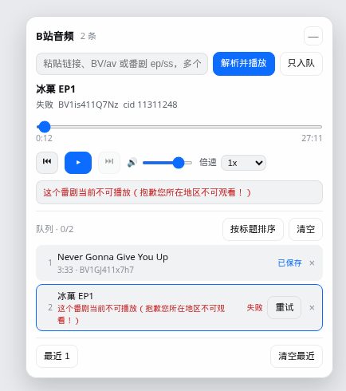

# dsh-bili-audio

A DSH plugin that treats Bilibili videos as podcasts: a floating player bar in the bottom-right corner of the DSH web UI. Paste a BV/av id, a video link, or a bangumi `ep`/`ss` link. Queue, seek, volume, speed and prev/next are included, and the queue plus play history survive a refresh. Copy follows the UI language (Chinese/English). No login and no cookies.

> Ported from a self-made Python desktop-pet implementation (`bili_audio.py` / `bili_player.py`). v0.2 is resolve, playback, queue, local queue/history, and bangumi `ep`/`ss`. No subtitles, login, downloads, or offline cache.

The bar itself, rendered from the client bundle (a restored queue: one saved row, one region-blocked failure). This is not a capture of the DSH window:



## Why a host-side proxy is required

Bilibili's audio CDNs (`*.bilivideo.com`, `*.mcdn.bilivideo.cn`, …) validate the `Referer` header. A browser pointed directly at an `.m4s` URL gets **403** because the page origin is localhost.

So all audio bytes flow through the host route `/bili-audio/api/stream`:

```
browser <audio>
   │  GET /bili-audio/api/stream?u=<encodeURIComponent(audioUrl)>   (+ Range)
   ▼
DSH host (Node)
   │  GET <audioUrl>
   │  User-Agent: desktop Chrome
   │  Referer: https://www.bilibili.com/
   ▼
Bilibili audio CDN  →  200 / 206 + audio bytes
```

The proxy forwards the browser's `Range` header and mirrors back `Content-Range`, `Accept-Ranges` and `Content-Length`, so seeking works via 206 partial responses.

## Install

Clone the repo and install that directory (`desktop` is the usual profile name; use yours):

```bash
git clone https://github.com/lihua12345670-jpg/dsh-bili-audio.git
dsh plugin --profile desktop add link:./dsh-bili-audio
```

From npm, once the package is published:

```bash
dsh plugin --profile desktop add dsh-bili-audio
```

After installation a round "♪" button appears in the bottom-right corner; click it to open the player bar. The plugin also shows up under Settings → Plugins.

## Usage

1. Click the "♪" button to expand the bar.
2. Paste a Bilibili link or id:
   - a video page (`https://www.bilibili.com/video/BV...`), a `b23.tv` short link, a BV id, or an av id;
   - a bangumi URL (`/bangumi/play/ep...`, `/bangumi/play/ss...`, `b23.tv/ep...`, `b23.tv/ss...`) or a bare `ep123` / `ss123`;
   - a media page (`/bangumi/media/md...`) is turned into its season and plays episode 1.
3. Press **Resolve & play** (Enter in the field does the same; Shift+Enter is **Queue only**).
4. Separate several items with spaces, newlines, or commas. **Queue only** appends without interrupting the current track.
5. Click a queue row to switch, × to remove, and use **Sort by title** / **Clear** at the top of the queue. A failure is written on that row (two lines, full text on hover).

An `ss` link or a media page with no episode id plays the **first regular episode**. Watch progress is not read, because that needs a login. `?ep_id=` or an `ep` in the path selects that episode.

When playback fails the client tries the backup CDN URLs, then re-resolves once (Bilibili audio URLs carry a `deadline`), and finally shows the concrete reason on the queue row.

While the bar is open and focus is not in the field or on a button:

| Key | Action |
| --- | --- |
| Space / media play | Play / pause |
| ← / → | Seek back / forward 10 seconds |
| Shift+← / Shift+→ | Previous / next |

## What is stored locally

`localStorage` in this browser only. Nothing is uploaded.

| Key | Contents |
| --- | --- |
| `dsh-bili-audio:prefs` | Expanded or minimized, volume, playback rate |
| `dsh-bili-audio:library` | Queue (link, title, bvid, cid, duration, error text), current item, playback position, play history (30 entries max) |

**Not stored, and not restored as a live stream:**

- CDN URLs and backup URLs (they carry a `deadline` and 403 when stale). After a refresh only the **current** item is resolved again; other rows resolve when you play them;
- whether audio was playing. The position is restored and playback stays paused until you press play;
- subtitles, cookies, login, downloads, offline audio bytes.

Clearing the queue does not clear history. Clicking a history row queues it again and plays it. The queue itself keeps at most 100 rows.

## API

| Method | Path | Description |
| --- | --- | --- |
| GET | `/bili-audio/api/health` | `{ok:true, version}` |
| GET | `/bili-audio/api/resolve?url=<BV/av/ep/ss/link>` | `{ok:true, title, bvid, cid, duration, page, pages, audioUrl, backups[], mimeType, codecs}`. Bangumi responses also include `epId` and `seasonId` |
| GET | `/bili-audio/api/stream?u=<urlencoded audioUrl>` | Audio byte proxy; supports `Range` and 206 |

Errors always look like:

```json
{ "error": { "code": "no_audio_stream", "message": "…" } }
```

Common codes: `missing_url`, `invalid_url`, `host_not_allowed`, `no_video_id`, `unsupported_link`, `video_not_found`, `bangumi_not_found`, `bangumi_restricted`, `episode_not_found`, `no_episode`, `no_audio_stream`, `playurl_failed`, `cdn_forbidden`, `cdn_gone`, `upstream_timeout`, `upstream_unreachable`, `short_link_foreign`.

`unsupported_link` is for pages the plugin recognizes and refuses: live, cheese, columns/opus, user space, the audio section, and bangumi index pages that have no id.

## Security boundaries

The plugin exposes a route that makes requests on the browser's behalf, so the allow-lists are hard-coded:

- `resolve` accepts only `bilibili.com` / `b23.tv` / `bilibili.tv` page links (including subdomains);
- `stream` proxies only `*.bilivideo.com`, `*.akamaized.net`, `*.mcdn.bilivideo.cn`, `*.bilibili.com`;
- after following CDN redirects the final host is validated again, so a CDN cannot redirect the proxy elsewhere;
- URLs with embedded credentials, non-`http(s)` schemes and IP literals (`127.0.0.1`, `[::1]`) are rejected;
- only the browser's `Range` header is forwarded — no `Cookie` / `Authorization`;
- every outbound request has a 15 s timeout, and the upstream is aborted as soon as the client disconnects.

It is not a general-purpose proxy: any URL outside those allow-lists gets a 400.

## Known limitations (v0.2)

- **No subtitles, login, cookies, downloads, or offline cache.** The original Python version fetched CC/AI subtitles with a login cookie. This plugin does not read cookies and does not forward `Cookie` or `Authorization` to Bilibili.
- **Online only**: resolve and playback depend on Bilibili APIs and CDNs. Queue metadata is local; audio bytes are not cached.
- Paid, premium, region-locked, or login-only items may expose no audio stream. The API then returns `no_audio_stream` or `bangumi_restricted`.
- An `ss` link or a media page resolves **one** episode (the first regular episode, or the episode named by `ep` / `?ep_id=`). The whole season is not queued automatically.
- Live, cheese, column, space, and audio-section links return `unsupported_link` instead of being guessed as videos.
- Autoplay after resolve may be blocked by the browser. A refresh does not autoplay either; press play once.

## Development

```bash
node --test tests/*.test.mjs   # unit tests (no network): resolve, bangumi, allow-lists, queue persistence, hotkeys
node scripts/smoke.mjs         # live smoke: a public video plus a public bangumi ep/ss, then proxy the first 200 KB
```

Override the live targets with `BILI_SMOKE_BVID` (default `BV1GJ411x7h7`), `BILI_SMOKE_EP` (default Journey to the West `ep327107`), and `BILI_SMOKE_SS` (default `ss33622`). A region block is reported as `bangumi_restricted` and fails the smoke run. On some networks `x/web-interface/view` answers 412; the plain-video step then fails, and the bangumi resolve plus its audio proxy still run.

Layout:

```
lib/index.js        host half: resolve / stream / health routes + allow-lists
lib/client.js       client half: shell.overlay floating bar (hand-written bundle, no build step)
cordis.patch.yml    mount declaration
tests/*.test.mjs    node --test suites
scripts/smoke.mjs   live network smoke test
```

## License

MIT. Ported from the user's own desktop-pet project. Audio copyright belongs to Bilibili and the respective uploaders; this plugin only plays audio locally — it does not download, re-host or redistribute content.
